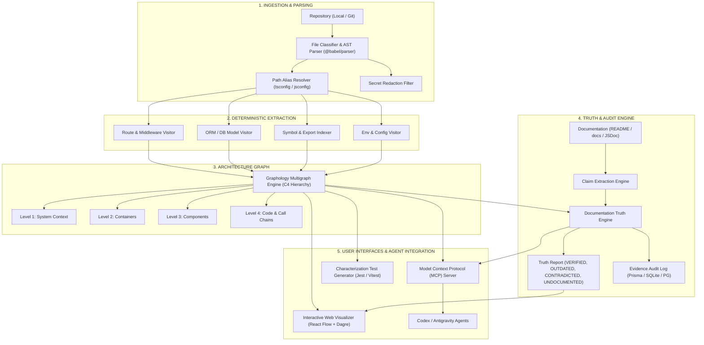

# RepoPulse — Stage 2: Architecture & Technical Plan

**Project:** RepoPulse — Living Architecture Cartographer & Truth Engine  
**Event:** GeeksforGeeks × OpenAI "Build with Codex" (1-Month Build Challenge)  
**Lifecycle Stage:** Stage 2 — Plan  
**Target Date:** November 2026  
**Author:** Manikanta (GitHub: `monkey9-Cyber-cat-Spidy`)  
**Core Motto:** *Evidence Before Intelligence*  

---

## 1. Executive Summary & Architectural Vision

RepoPulse is an open-source, evidence-grounded Architecture Cartographer and Documentation Truth Engine for modern software repositories. Traditional software documentation decays into fiction as codebases evolve; developers are forced to manually traverse files and decipher implicit dependencies. Generic AI assistants compound the problem by hallucinating non-existent routes, obsolete dependencies, or fabricated file structures.

RepoPulse solves this through an unyielding architectural tenet: **Evidence Before Intelligence**. 

Every architectural diagram, dependency edge, documentation truth verdict, and AI-assisted query answer must be backed by an immutable **Evidence Pointer** linking directly to exact file paths, start-to-end line numbers, AST token spans, and source code excerpts.



---

## 2. Monorepo Structure & Package Boundaries

RepoPulse is organized as a high-performance TypeScript monorepo using npm/pnpm workspaces:

```
repopulse/
├── packages/
│   ├── scanner/              # AST parsing, symbol indexing, visitor engines, secret redaction
│   │   ├── src/
│   │   │   ├── parser.ts     # Babel & TypeScript AST parsing engine
│   │   │   ├── resolver.ts   # Node.js + tsconfig module path resolver
│   │   │   ├── visitors/     # Route, Model, Env, Dependency, and Symbol visitors
│   │   │   ├── redactor.ts   # Deterministic API key & credential scrubber
│   │   │   └── types.ts      # AST & Symbol data types
│   │   └── tests/
│   ├── graph/                # Graphology C4 engine, graph algorithms, layout calculators
│   │   ├── src/
│   │   │   ├── c4-builder.ts # Generates Context, Container, Component, Code graphs
│   │   │   ├── algorithms.ts # PageRank, cycle detection, critical path, topological sort
│   │   │   ├── export.ts     # React Flow node/edge formatter, Mermaid & D2 exporter
│   │   │   └── types.ts
│   │   └── tests/
│   ├── truth-engine/         # Markdown claim extractor, truth scoring, contradiction detector
│   │   ├── src/
│   │   │   ├── claim-extractor.ts # Extracts factual claims from markdown files
│   │   │   ├── verifier.ts        # Compares claims against AST graph
│   │   │   ├── scorer.ts          # Computes 0-100% Documentation Truth Score
│   │   │   └── test-generator.ts  # Synthesizes behavioral characterization tests
│   │   └── tests/
│   ├── mcp-server/           # Standardized Model Context Protocol server (stdio & SSE)
│   │   ├── src/
│   │   │   ├── index.ts      # MCP Server entry point
│   │   │   ├── tools/        # repopulse_scan, get_graph, query_symbol, verify_claims, etc.
│   │   │   ├── resources/    # repopulse:// graph, truth, and route resources
│   │   │   └── prompts/      # Architectural investigation prompt templates
│   │   └── tests/
│   ├── db/                   # Prisma schema, SQLite/PG adapters, migrations, repositories
│   │   ├── prisma/
│   │   │   └── schema.prisma # Canonical relational data model
│   │   └── src/
│   │       ├── client.ts     # Dual-engine Prisma client (SQLite / PostgreSQL)
│   │       └── repos/        # Type-safe repository data access layers
│   ├── cli/                  # Command-line interface (`repopulse scan`, `repopulse verify`)
│   │   └── src/
│   │       └── index.ts      # Command handlers using Commander.js / Chalk
│   └── web/                  # Next.js / React 19 interactive architecture visualizer
│       ├── src/
│       │   ├── components/   # React Flow canvas, C4 level switcher, Evidence Drawer
│       │   ├── pages/        # Dashboard, Explorer, Truth Scorecard, API Catalog
│       │   └── hooks/        # Graph query & filter hooks
│       └── tests/
├── docs/                     # Specifications, C4 documentation, ADRs
│   ├── adr/                  # Architecture Decision Records (001 - 005)
│   └── STAGE_2_PLAN.md       # This comprehensive architecture document
├── evidence-pack/            # Contest Evidence Pack across all 8 stages
├── package.json              # Monorepo root workspace configuration
├── tsconfig.json             # Root TypeScript compiler options
└── AGENTS.md                 # Agent guidelines, boundaries, and commands
```

---

## 3. Database Schema (Prisma Specification)

To ensure zero-friction local developer onboarding and enterprise-scale team deployments (see [ADR 002](file:///f:/GFG%20competition/repopulse/docs/adr/002-dual-mode-persistence-sqlite-postgres.md)), RepoPulse utilizes Prisma ORM with SQLite for local CLI use and PostgreSQL for hosted environments.

```prisma
datasource db {
  provider = "sqlite" // Configurable to "postgresql" via DATABASE_URL
  url      = env("DATABASE_URL")
}

generator client {
  provider = "prisma-client-js"
}

enum Language {
  JAVASCRIPT
  TYPESCRIPT
  JSX
  TSX
  JSON
  MARKDOWN
  UNKNOWN
}

enum SymbolKind {
  FUNCTION
  CLASS
  METHOD
  VARIABLE
  INTERFACE
  TYPE_ALIAS
  EXPRESS_ROUTE
  EXPRESS_ROUTER
  MIDDLEWARE
  ORM_MODEL
  ENV_VAR
}

enum ClaimStatus {
  VERIFIED
  OUTDATED
  CONTRADICTED
  UNDOCUMENTED
}

enum EdgeType {
  IMPORTS
  CALLS
  MOUNTS_ROUTE
  USES_MIDDLEWARE
  QUERIES_MODEL
  READS_ENV
  CALLS_EXTERNAL_API
}

model Repository {
  id             String          @id @default(uuid())
  name           String
  rootPath       String
  remoteUrl      String?
  commitSha      String?
  scannedAt      DateTime        @default(now())
  locTotal       Int             @default(0)
  truthScore     Float?          @default(0.0)
  
  files          FileNode[]
  symbols        Symbol[]
  routes         RouteEndpoint[]
  models         DataModel[]
  dependencies   Dependency[]
  docClaims      DocClaim[]
  audits         EvidenceAudit[]
  tests          CharacterizationTest[]
  graphs         ArchitectureGraph[]

  @@index([name])
}

model FileNode {
  id             String        @id @default(uuid())
  repositoryId   String
  relativePath   String
  language       Language      @default(JAVASCRIPT)
  loc            Int           @default(0)
  sizeBytes      Int           @default(0)
  sha256Hash     String
  isEntrypoint   Boolean       @default(false)
  
  repository     Repository    @relation(fields: [repositoryId], references: [id], onDelete: Cascade)
  symbols        Symbol[]
  sourceDeps     Dependency[]  @relation("SourceFileDeps")
  targetDeps     Dependency[]  @relation("TargetFileDeps")
  routes         RouteEndpoint[]
  models         DataModel[]

  @@unique([repositoryId, relativePath])
  @@index([repositoryId])
}

model Symbol {
  id             String        @id @default(uuid())
  repositoryId   String
  fileNodeId     String
  name           String
  kind           SymbolKind
  isExported     Boolean       @default(false)
  isDefaultExport Boolean      @default(false)
  
  startLine      Int
  endLine        Int
  startColumn    Int
  endColumn      Int
  astNodeType    String
  signature      String?
  docstring      String?
  
  fileNode       FileNode      @relation(fields: [fileNodeId], references: [id], onDelete: Cascade)
  repository     Repository    @relation(fields: [repositoryId], references: [id], onDelete: Cascade)

  @@index([repositoryId, name])
  @@index([fileNodeId])
}

model Dependency {
  id             String        @id @default(uuid())
  repositoryId   String
  sourceFileId   String
  targetFileId   String?
  importStatement String
  importedNames  String        // JSON array of strings
  isDynamic      Boolean       @default(false)
  resolvedPath   String?
  
  repository     Repository    @relation(fields: [repositoryId], references: [id], onDelete: Cascade)
  sourceFile     FileNode      @relation("SourceFileDeps", fields: [sourceFileId], references: [id], onDelete: Cascade)
  targetFile     FileNode?     @relation("TargetFileDeps", fields: [targetFileId], references: [id], onDelete: SetNull)

  @@index([repositoryId])
  @@index([sourceFileId])
}

model RouteEndpoint {
  id             String        @id @default(uuid())
  repositoryId   String
  fileNodeId     String
  httpMethod     String        // GET, POST, PUT, DELETE, PATCH, USE
  pathPattern    String        // e.g. "/api/v1/orders/:id"
  rawMountPath   String?       // Sub-router mount prefix
  fullPath       String        // Fully resolved router path
  handlerSymbol  String?
  middlewareJson String        // JSON array of middleware symbol names/references
  startLine      Int
  endLine        Int
  
  repository     Repository    @relation(fields: [repositoryId], references: [id], onDelete: Cascade)
  fileNode       FileNode      @relation(fields: [fileNodeId], references: [id], onDelete: Cascade)

  @@index([repositoryId, httpMethod, fullPath])
}

model DataModel {
  id             String        @id @default(uuid())
  repositoryId   String
  fileNodeId     String
  ormType        String        // PRISMA, MONGOOSE, SEQUELIZE, TYPEORM, RAW_SQL
  modelName      String        // e.g. "Order", "Product", "Customer"
  tableName      String?
  schemaJson     String        // Extracted field names and types (JSON string)
  relationsJson  String?       // Foreign keys, references, relations (JSON string)
  startLine      Int
  endLine        Int
  
  repository     Repository    @relation(fields: [repositoryId], references: [id], onDelete: Cascade)
  fileNode       FileNode      @relation(fields: [fileNodeId], references: [id], onDelete: Cascade)

  @@index([repositoryId, modelName])
}

model DocClaim {
  id             String        @id @default(uuid())
  repositoryId   String
  sourceDocPath  String        // e.g. "README.md"
  claimCategory  String        // API_ROUTE, DATABASE, AUTHENTICATION, ARCHITECTURE, ENVIRONMENT
  rawClaimText   String
  claimedEntity  String        // e.g. "GET /api/orders", "PostgreSQL", "JWT"
  status         ClaimStatus   @default(UNDOCUMENTED)
  confidence     Float         @default(1.0)
  explanation    String
  
  evidenceFile   String?
  evidenceLines  String?       // e.g. "L45-L62"
  
  repository     Repository    @relation(fields: [repositoryId], references: [id], onDelete: Cascade)

  @@index([repositoryId, status])
}

model EvidenceAudit {
  id             String        @id @default(uuid())
  repositoryId   String
  entityType     String        // ROUTE, MODEL, CLAIM, SYMBOL
  entityIdentifier String
  filePath       String
  commitSha      String?
  startLine      Int
  endLine        Int
  astNodeType    String
  codeExcerpt    String        // Sanitized excerpt with secrets scrubbed
  verifiedAt     DateTime      @default(now())

  repository     Repository    @relation(fields: [repositoryId], references: [id], onDelete: Cascade)

  @@index([repositoryId, entityType])
}

model CharacterizationTest {
  id             String        @id @default(uuid())
  repositoryId   String
  targetEntity   String        // e.g. "POST /api/orders" or "calculateTax"
  testFramework  String        @default("VITEST") // VITEST, JEST
  testCode       String
  inputVectors   String        // JSON of simulated inputs
  expectedOutput String        // JSON of observed outputs
  executionState String        @default("PROPOSED") // PROPOSED, VERIFIED, FAILED
  runOutput      String?
  createdAt      DateTime      @default(now())

  repository     Repository    @relation(fields: [repositoryId], references: [id], onDelete: Cascade)

  @@index([repositoryId, targetEntity])
}

model ArchitectureGraph {
  id             String        @id @default(uuid())
  repositoryId   String
  c4Level        Int           // 1 = Context, 2 = Container, 3 = Component, 4 = Code
  graphJson      String        // Serialized Graphology graph / React Flow elements
  createdAt      DateTime      @default(now())

  repository     Repository    @relation(fields: [repositoryId], references: [id], onDelete: Cascade)

  @@unique([repositoryId, c4Level])
}
```

---

## 4. AST Parsing Pipeline & Visitor Design

The AST scanner in `packages/scanner` analyzes repositories without ever executing untrusted code (see [ADR 001](file:///f:/GFG%20competition/repopulse/docs/adr/001-hybrid-ast-and-symbol-resolution.md) and [ADR 005](file:///f:/GFG%20competition/repopulse/docs/adr/005-sandboxed-static-analysis-security.md)).

### 4.1 Parser Execution Flow
1. **File Enumeration:** Recursively scans repository files while respecting `.gitignore`, excluding `node_modules/`, `.git/`, `dist/`, `build/`, and binary assets.
2. **Sanitization & Secret Redaction:** File content passes through `packages/scanner/src/redactor.ts` which uses deterministic regex patterns to detect and mask API keys, private keys, and passwords before any AST tokens are processed.
3. **AST Generation:** Invokes `@babel/parser` with full ECMAScript and TypeScript plugins enabled in `errorRecovery: true` mode:
   ```typescript
   import { parse } from '@babel/parser';

   const ast = parse(sourceCode, {
     sourceType: 'unambiguous',
     plugins: [
       'typescript',
       'jsx',
       'decorators-legacy',
       'classProperties',
       'classPrivateProperties',
       'classPrivateMethods',
       'dynamicImport',
       'topLevelAwait',
       'nullishCoalescingOperator',
       'optionalChaining'
     ],
     errorRecovery: true,
     tokens: true
   });
   ```

### 4.2 Modular AST Visitors
Traversals are performed using `@babel/traverse` with specialized visitor patterns:

```
┌────────────────────────────────────────────────────────┐
│                   Babel AST Node                       │
└────────────────────────────────────────────────────────┘
          │                   │                  │
          ▼                   ▼                  ▼
┌──────────────────┐ ┌─────────────────┐ ┌───────────────┐
│   RouteVisitor   │ │  ModelVisitor   │ │  EnvVisitor   │
│  - app.get/post  │ │ - mongoose.model│ │- process.env  │
│  - router.use()  │ │ - Prisma schema │ │- config vars  │
│  - middleware [] │ │ - sequelize.def │ └───────────────┘
└──────────────────┘ └─────────────────┘
          │                   │                  │
          └───────────────────┼──────────────────┘
                              ▼
┌────────────────────────────────────────────────────────┐
│            Path Resolver & Linker (tsconfig)           │
│  - Links routes to mounted subrouters & controllers    │
│  - Connects imports to resolved physical files         │
└────────────────────────────────────────────────────────┘
```

#### A. RouteVisitor (Express / Fastify / Node HTTP)
- Identifies Express initialization (`express()`, `express.Router()`).
- Matches `CallExpression` nodes where member expressions invoke HTTP methods:
  - Methods: `get`, `post`, `put`, `delete`, `patch`, `use`, `all`.
  - Extracts the first string literal argument as the route path (e.g., `'/api/orders'`).
  - Iterates subsequent arguments to map middleware functions in sequence (e.g., `[authenticate, validateOrderBody, createOrder]`).
  - Tracks sub-router mounts: When encountering `app.use('/api/v1/khata', khataRouter)`, it records the mount path and recursively prepends it to all routes defined inside `khataRouter`.

#### B. ModelVisitor (Mongoose / Prisma / Sequelize)
- **Mongoose:** Detects `mongoose.model('ModelName', SchemaDefinition)` and `new mongoose.Schema({ ... })`. Extracts schema keys, field types (`String`, `Number`, `ObjectId`), required constraints, and references (`ref: 'Customer'`).
- **Prisma:** Parses `schema.prisma` using AST regex/token extraction to obtain models, attributes (`@id`, `@unique`, `@relation`), and cross-model foreign keys.
- **Sequelize:** Matches `sequelize.define('ModelName', { ... })` and ES6 classes extending `Model`.

#### C. EnvVisitor
- Detects `MemberExpression` nodes accessing `process.env.<NAME>` or `process.env['<NAME>']`.
- Records which file and function require specific environment variables, generating an accurate `.env.example` specification of actually utilized configurations.

#### D. DependencyVisitor & Path Resolver
- Traverses `ImportDeclaration` (`import x from 'y'`), `ExportNamedDeclaration`, `ExportDefaultDeclaration`, and `CallExpression` (`require('z')`, `import('w')`).
- Resolves paths using Node.js module resolution algorithms plus `paths` mappings defined in `tsconfig.json` / `jsconfig.json`.

---

## 5. Hierarchical C4 Graph Data Model

To prevent diagram overcrowding and enable true architectural comprehension (see [ADR 003](file:///f:/GFG%20competition/repopulse/docs/adr/003-c4-graphology-data-model.md)), RepoPulse implements a 4-tier C4 Model:

```
┌─────────────────────────────────────────────────────────────────┐
│ LEVEL 1: SYSTEM CONTEXT                                         │
│ Users ──► [ RepoPulse / App ] ──► External APIs (Stripe, Twilio) │
│                               └──► Databases (PostgreSQL, Mongo)│
└────────────────────────────────┬────────────────────────────────┘
                                 │ Zoom In
┌────────────────────────────────▼────────────────────────────────┐
│ LEVEL 2: CONTAINERS                                             │
│ [Web Frontend] ──► [Express API Gateway] ──► [Worker Queue]     │
│                             │                                   │
│                             └──► [Primary Relational DB]        │
└────────────────────────────────┬────────────────────────────────┘
                                 │ Zoom In
┌────────────────────────────────▼────────────────────────────────┐
│ LEVEL 3: COMPONENTS                                             │
│ [OrderRouter] ──► [AuthMiddleware] ──► [OrderService]           │
│                             │                  │                │
│                             ▼                  ▼                │
│                     [JWTVerifier]      [OrderModel (Prisma)]    │
└────────────────────────────────┬────────────────────────────────┘
                                 │ Zoom In
┌────────────────────────────────▼────────────────────────────────┐
│ LEVEL 4: CODE                                                   │
│ function calculateTax(items, slab) { ... L102-L145 }            │
│  - Exact AST symbols, variable definitions, and line ranges     │
└─────────────────────────────────────────────────────────────────┘
```

### 5.1 Graphology Representation
The in-memory graph is instantiated as a `graphology.DirectedMultigraph`.
- **Node Attributes:**
  ```typescript
  interface C4NodeAttributes {
    id: string;
    label: string;
    c4Level: 1 | 2 | 3 | 4;
    kind: 'SYSTEM' | 'CONTAINER' | 'COMPONENT' | 'CODE' | 'EXTERNAL_SERVICE' | 'DATABASE';
    filePath?: string;
    startLine?: number;
    endLine?: number;
    loc?: number;
    technologies: string[];
    evidencePointerId?: string;
  }
  ```
- **Edge Attributes:**
  ```typescript
  interface C4EdgeAttributes {
    id: string;
    type: 'IMPORTS' | 'CALLS' | 'MOUNTS' | 'MIDDLEWARE' | 'QUERIES' | 'READS_CONFIG';
    description: string;
    weight: number;
    isSynchronous: boolean;
  }
  ```

### 5.2 React Flow & Auto-Layout
Graphs are formatted for React Flow with pre-computed coordinates generated by `@dagrejs/dagre`:
- Renders custom node components with visual indicators for C4 level, technology badge (Express, Mongoose, PostgreSQL, Redis), and direct "View Evidence" action triggers.
- Split-screen drawer: Clicking any node or edge instantly pulls up the source code viewer anchored to the exact lines that prove the connection.

---

## 6. Documentation Truth Engine Specification

The Documentation Truth Engine bridges the gap between written intent and codebase reality (see [ADR 004](file:///f:/GFG%20competition/repopulse/docs/adr/004-evidence-before-intelligence-protocol.md)).

### 6.1 Claim Extraction Pipeline
1. Ingests all Markdown files (`README.md`, `CONTRIBUTING.md`, `docs/**/*.md`).
2. Parses text into structural AST tokens using `unified` + `remark-parse`.
3. Identifies testable architectural assertions:
   - **Route assertions:** e.g., *"Provides `POST /api/orders` to submit an order"* or lists of HTTP endpoints in markdown tables.
   - **Database assertions:** e.g., *"Backed by MongoDB"* or *"Uses Prisma with PostgreSQL"*.
   - **Authentication assertions:** e.g., *"Protected with JWT bearer authentication"*.
   - **Environment variable assertions:** e.g., Markdown configuration tables listing required keys like `PORT`, `JWT_SECRET`, `DATABASE_URL`.

### 6.2 Deterministic Verification Logic
For each extracted claim $C$:
1. Query the deterministic AST index for matching entity $E$.
2. Compute verdict:
   - **`VERIFIED` (Confidence 1.0):** Entity exists, configuration matches, parameter patterns correspond with code implementation.
   - **`OUTDATED` (Confidence 0.85):** Entity exists but signatures or counts have changed (e.g., documentation lists 12 endpoints; AST discovered 19).
   - **`CONTRADICTED` (Confidence 0.95):** Document claims technology $X$ (e.g., MongoDB), but code AST proves technology $Y$ (e.g., PostgreSQL with Prisma).
   - **`UNDOCUMENTED`:** Discovered AST entities of major significance (e.g., an entire `/api/v1/admin/export` route or a WebSocket handler) that have zero presence in documentation.

### 6.3 Truth Score Formulation
The repository-wide **Documentation Truth Score** $T$ is computed as:
$$T = \frac{N_{\text{verified}}}{N_{\text{verified}} + 1.5 \cdot N_{\text{contradicted}} + 0.8 \cdot N_{\text{outdated}} + 0.5 \cdot N_{\text{undocumented}}} \times 100\%$$

Where:
- $N_{\text{verified}}$: Number of verified documentation claims.
- $N_{\text{contradicted}}$: Claims directly contradicted by source code (heavy penalty).
- $N_{\text{outdated}}$: Claims that are stale or partially deviated.
- $N_{\text{undocumented}}$: Major architectural components missing from documentation.

---

## 7. Model Context Protocol (MCP) Server Design

RepoPulse exposes a native MCP server (`packages/mcp-server`) conforming to the Model Context Protocol specification. This allows Codex, Antigravity, and Claude Code agents to interact with the repository's living architecture directly.

### 7.1 Tools Catalog

| Tool Name | Parameters | Description | Output Schema |
|:---|:---|:---|:---|
| `repopulse_scan` | `repoPath: string`, `options?: { maxDepth: number }` | Triggers deterministic AST indexing and graph construction on target repository. | `{ scanId: string, totalFiles: number, totalLOC: number, durationMs: number }` |
| `repopulse_get_graph` | `c4Level?: 1\|2\|3\|4`, `filterKind?: string` | Returns the hierarchical C4 architecture graph for the scanned repository. | `{ nodes: C4Node[], edges: C4Edge[], layout: 'dagre' }` |
| `repopulse_query_symbol` | `name: string`, `kind?: string` | Finds symbol definitions, callers, callees, export status, and exact line coordinates. | `{ symbol: Symbol, callers: Symbol[], callees: Symbol[], evidence: EvidencePointer }` |
| `repopulse_trace_dataflow` | `startEndpoint: string` | Traces full execution path from HTTP endpoint through middleware, service, to database query. | `{ route: RouteEndpoint, callStack: string[], modelsAccessed: string[], evidencePointers: EvidencePointer[] }` |
| `repopulse_verify_claims` | `docPath?: string` | Audits documentation against AST facts and returns Truth Score and categorized findings. | `{ truthScore: number, claims: DocClaim[], breakdown: { verified: number, contradicted: number, ... } }` |
| `repopulse_get_evidence` | `evidenceId: string` | Retrieves the immutable source proof (file, commit, exact lines, sanitized code excerpt). | `{ filePath: string, startLine: number, endLine: number, codeSnippet: string }` |
| `repopulse_propose_test` | `target: string`, `framework?: 'VITEST'\|'JEST'` | Generates behavioral characterization tests capturing existing behavior without modifying code. | `{ testCode: string, inputVectors: any[], targetEntity: string }` |

### 7.2 MCP Resources & Prompts
- **Resources:**
  - `repopulse://graph/c4`: Live JSON stream of the C4 architecture graph.
  - `repopulse://truth/report`: Current documentation truth scorecard and breakdown.
  - `repopulse://catalog/routes`: Complete inventory of all discovered API routes, methods, and middleware.
- **Prompts:**
  - `audit_documentation`: Instructs the agent to review all contradicted and outdated documentation claims and generate an updated `README.md` PR.
  - `trace_architecture_impact`: Given a proposed function or schema change, traces all downstream components that will be impacted.

---

## 8. Model & Reasoning-Effort Discipline Strategy

To achieve the maximum score (20/20) on the **Model & Reasoning-Effort Discipline** contest judging pillar, RepoPulse implements a three-tier execution hierarchy:

```
┌────────────────────────────────────────────────────────────────────────┐
│ TIER 1: DETERMINISTIC AST & GRAPH ENGINE (0 LLM Tokens)                │
│ - AST parsing (@babel/parser), symbol indexing, path resolution        │
│ - Express route extraction, Mongoose/Prisma schema parsing             │
│ - Graphology multigraph construction, Dagre topological layout         │
│ Cost: $0.00 | Latency: < 300ms | Hallucination Risk: 0.00%             │
└───────────────────────────────────┬────────────────────────────────────┘
                                    │ Outputs Verified Symbol Tables
┌───────────────────────────────────▼────────────────────────────────────┐
│ TIER 2: FAST REASONING ENGINE (Low Effort / Small Model)               │
│ - Markdown documentation claim extraction & semantic chunking          │
│ - Fuzzy matching between natural language claims & discovered symbols  │
│ Cost: Ultra-low | Latency: 1-2s | Task: Structured NLP Extraction      │
└───────────────────────────────────┬────────────────────────────────────┘
                                    │ High-Complexity Edge Cases
┌───────────────────────────────────▼────────────────────────────────────┐
│ TIER 3: HIGH REASONING ENGINE (Deep Thought / o3-mini / High Effort)   │
│ - Multi-file dynamic data-flow synthesis across async queues           │
│ - Behavioral Characterization Test synthesis capturing legacy edge-case │
│   behaviors without regression                                         │
│ - Architectural trade-off analysis and root-cause explanation          │
│ Cost: Controlled | Reasoning Effort: High | Value: Critical Insights   │
└────────────────────────────────────────────────────────────────────────┘
```

---

## 9. Characterization Test Generator Specification

Legacy codebases often contain undocumented behaviors, implicit type coercions, and unstated edge cases (as observed in `ShopLedger v0.8.4`'s Khata calculations). Modifying such code without tests is reckless.

RepoPulse's **Characterization Test Generator**:
1. Analyzes target function signatures, branch conditions (`if`, `switch`, ternary), and input destructurings via AST.
2. Identifies parameter types and generates boundary input vectors (e.g., zero values, negative numbers, missing properties, array inputs).
3. Synthesizes a self-contained Vitest/Jest test suite that executes the function in a sandboxed Node worker thread and asserts the *current observable output*:
   ```typescript
   // Example generated characterization test for legacy ShopLedger tax calculation
   import { describe, it, expect } from 'vitest';
   import { calculateTax } from '../lib/tax';

   describe('Characterization: calculateTax (Existing Observable Behavior)', () => {
     it('calculates GST accurately for 5% slab with positive quantity', () => {
       const result = calculateTax([{ price: 100, gstRate: 5, quantity: 2 }]);
       expect(result.taxTotal).toBe(10);
       expect(result.cgst).toBe(5);
       expect(result.sgst).toBe(5);
     });

     it('captures existing behavior when price is zero', () => {
       const result = calculateTax([{ price: 0, gstRate: 18, quantity: 1 }]);
       expect(result.taxTotal).toBe(0);
     });
   });
   ```
4. Stores the generated test in the `CharacterizationTest` table with status `PROPOSED`. Developers can inspect, run, and commit tests with full confidence before refactoring.

---

## 10. Execution Roadmap & Lifecycle Progression

| Lifecycle Stage | Goals & Deliverables | Verification Target |
|:---|:---|:---|
| **Stage 1: Understand** | Problem definition, value proposition, feature scope, contest criteria alignment. | Documented in `evidence-pack/stage-1-understand/` *(Complete)* |
| **Stage 2: Plan** | Database schema, AST visitors, C4 graph model, MCP tools, 5 ADRs. | Documented in `docs/STAGE_2_PLAN.md` & `docs/adr/` *(Current)* |
| **Stage 3: Setup** | Scaffolding monorepo (`packages/*`), TypeScript, Vitest, Prisma, `AGENTS.md`. | Monorepo compiles cleanly; CI pipeline passes initial lints. |
| **Stage 4: Build** | Implement `scanner`, `graph`, `truth-engine`, `mcp-server`, and React Flow `web`. | Complete scanner extraction on both `ShopLedger` and `Local-SEO-Pro`. |
| **Stage 5: Test** | Comprehensive test suite (>85% coverage), characterization tests, integration tests. | Vitest test runner reports 100% pass across all packages. |
| **Stage 6: Debug** | Memory profiling, cycle resolution in Graphology, edge-case AST error recovery. | Zero parser crashes on syntactically malformed legacy files. |
| **Stage 7: Ship** | Docker containerization, standalone CLI distribution (`npx repopulse`), live demo deployment. | Public live URL and runnable release package. |
| **Stage 8: Automate** | GitHub Actions CI/CD, automated documentation drift PR generator, complete Evidence Pack. | Public GitHub repo, release tags, full evidence pack ready for judges. |

---

**Next Action:** Proceed to **Stage 3: Setup** — Initialize Monorepo workspaces, configure TypeScript and Prisma, and scaffold package structures.
